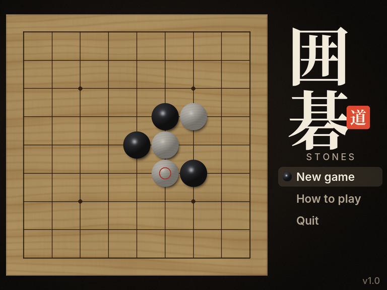
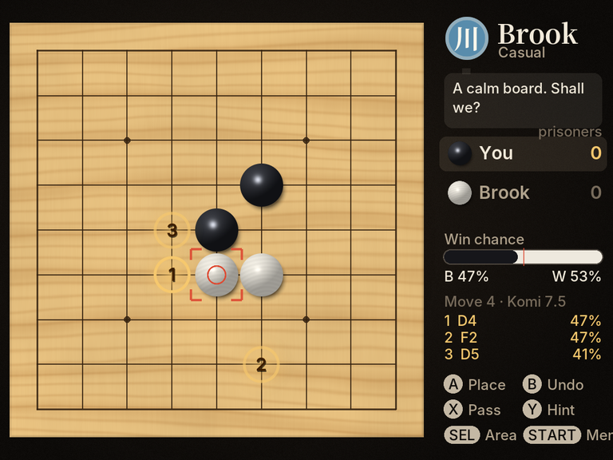
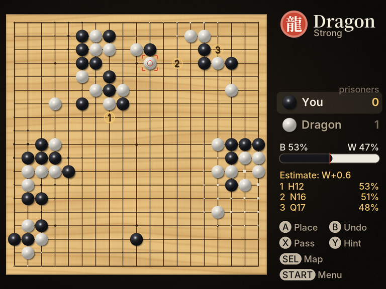
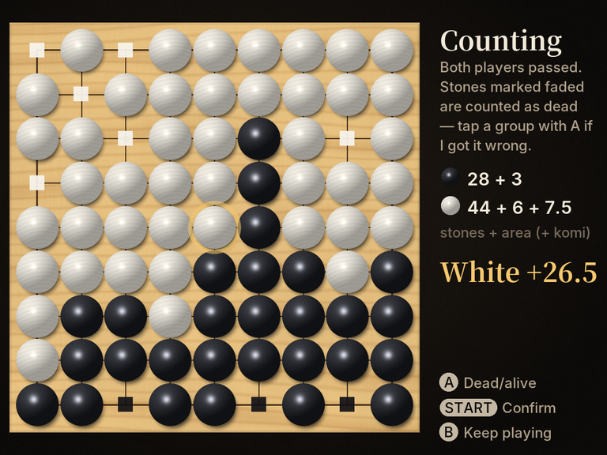
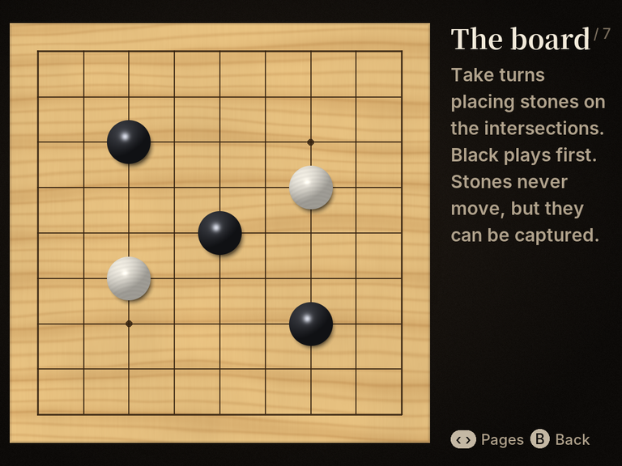

# Stones — Go for the TrimUI Brick

A native Go (囲碁 / baduk / weiqi) game for the **TrimUI Brick** and **Brick Hammer**, packaged as a [NextUI](https://github.com/LoveRetro/NextUI) Tool pak. Written in C and SDL2: four AI opponents with personalities, hints, a live win-probability bar, and hot-seat play for two.



| Hints and win chance | 19×19 with territory map |
|---|---|
|  |  |
| **Counting at the end** | **Built-in tutorial** |
|  |  |

## Install

1. Download `Stones.pakz` from the [latest release](../../releases/latest).
2. Copy it to the **root** of your SD card and boot NextUI. It installs itself.
3. Open **Tools → Stones**.

If you'd rather unpack it yourself, unzip `Stones-sdcard.zip` at the SD card root so you get `Tools/tg5040/Stones.pak/`.

The pak targets `tg5040`, so it should also run on the Brick Pro and Smart Pro (the layout adapts to 1280×720). Only the Brick Hammer has been tested on real hardware.

## Controls

| Button | Action |
|---|---|
| D-pad | Move the cursor |
| A | Place a stone |
| B | Take back a move |
| X | Pass |
| Y | Show the AI's top 3 suggestions |
| SELECT | Territory map and score estimate |
| L1 | Jump to the last move |
| START | Menu: sound, atari alerts, resign, save & exit, quit |

## Opponents

| | Name | Level |
|---|---|---|
| 石 | Pebble | Beginner: plays loosely and makes mistakes |
| 川 | Brook | Casual |
| 山 | Mountain | Club player |
| 龍 | Dragon | Strongest; thinks up to ~10 s per move on 19×19 |
| 友 | A friend | Two players, one Brick |

All of them use **Monte Carlo tree search** (UCT with RAVE), the search half of AlphaGo minus the neural networks: thousands of fast random playouts per move with tactical heuristics (captures, escaping atari), run in parallel across the Brick's four Cortex-A53 cores.

## Rules

- 9×9, 13×13 and 19×19 boards; 2–9 handicap stones
- Chinese area scoring, komi 7.5 (0.5 with handicap), simple ko
- After both players pass, the game proposes dead stones; press A on a group to flip it, START to confirm

## Saves and logs

- Games auto-save after every move (**Continue** on the title screen).
- Finished games are written as SGF to `SD:/.userdata/shared/Stones/games/`, so you can review them in any Go program.
- Log: `SD:/.userdata/tg5040/logs/Stones.txt`

## Building from source

Requires Linux (x86-64), `make`, `curl` and `zip`.

```sh
make sdk        # downloads TrimUI's official toolchain + SDK into ./sdk (~400 MB)
make pak        # builds dist/Stones.pakz and dist/Stones-sdcard.zip
```

For development on a desktop with SDL2 installed:

```sh
make host && STONES_WINDOW=1024x768 ./build/stones-host
make test       # rules-engine tests
```

Keyboard on desktop: arrows/WASD move, Space place, Backspace undo, P pass, H hint, Tab territory, Esc menu.

Fonts are pre-baked into `src/font_data.h` so the game needs no font files at runtime. `make fonts` regenerates it (needs Python + Pillow and the Inter and Noto Serif CJK fonts installed).

### Source layout

| File | What it does |
|---|---|
| `src/go.c` | Rules engine: incremental strings, pseudo-liberties, O(1) atari detection |
| `src/ai.c` | Parallel MCTS with RAVE, priors and ownership estimates |
| `src/main.c` | Screens, input, animations, opponents, saving, SGF export |
| `src/gfx.c` | Procedural wood board and stones, baked-font text rendering |
| `src/audio.c` | Every sound is synthesised at startup, no audio files |

## License

MIT, except the embedded font glyphs (SIL OFL 1.1). See [LICENSE](LICENSE).
